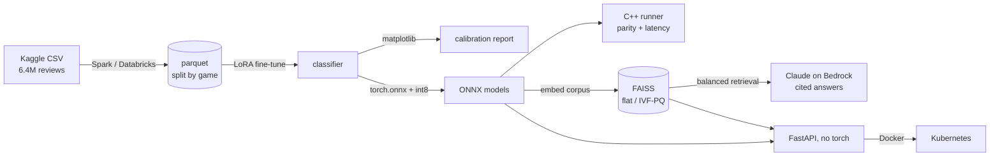
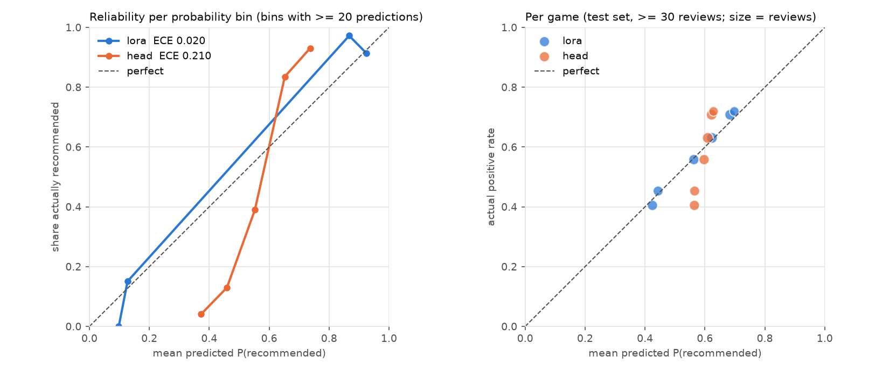
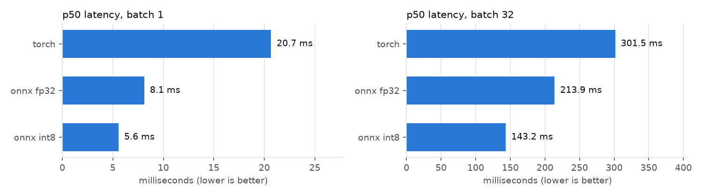

# reviewscope

What players actually say about a game, from millions of Steam reviews.

The pipeline cleans and splits ~6.4M reviews with **Spark**. It fine-tunes a small
encoder with **LoRA** to predict whether a review recommends the game, and checks
that model's calibration with **matplotlib** reliability diagrams. It exports the
model to **ONNX** and runs it from Python and from a **C++** runner. Reviews are
searched with a **FAISS** vector index, and **Claude on Amazon Bedrock** answers
questions about a game from cited review snippets. The torch-free API is deployed
to **Kubernetes**.

On each push, CI runs the Spark ETL, training, calibration, ONNX export, the C++
runner's parity check, the index build and a kind deployment, all on synthetic
data. It does not call Bedrock (the RAG step runs with `--dry-run`) or run the
Databricks notebook; both need cloud accounts.

The point of the project is that each tool is there because the data needs it.
The section [Why each tool is here](#why-each-tool-is-here) says what each one
buys and when it would be the wrong choice.



## Results

Measured on the real [Kaggle Steam reviews](https://www.kaggle.com/datasets/andrewmvd/steam-reviews)
dump, on a laptop CPU with no GPU. That budget is why training used a 30k-review
sample rather than the 3.4M available, for one epoch.

| Stage | Metric | Value |
|---|---|---|
| Spark ETL | raw rows → kept after cleaning and dedupe | 6,417,106 → **4,400,530** |
| | split by game: train / val / test | 3.43M / 475k / 493k reviews; 7,299 / 917 / 874 games |
| | same job on Databricks serverless (Free Edition) | identical counts, 324 s |
| Classifier, DistilBERT, 30k train rows, test = 10k reviews of 55 unseen games | LoRA (r=8, 1.1% of params trained) | **90.8%** accuracy, AUC **0.936**, macro-F1 **0.830** |
| | head only (encoder frozen) | 87.9%, AUC 0.896, macro-F1 0.758 |
| | always "recommended" | 82.5%, macro-F1 0.45 |
| Calibration | ECE, LoRA / head only | 0.007 / 0.006 |
| | per-game positive rate, mean abs error, LoRA / head | **0.046** / 0.060 |
| ONNX parity | max abs logit diff vs PyTorch, Python ORT / C++ runner | 3e-6 / 3e-6 |
| C++ runner (ORT 1.31, Linux container, 4 threads), batch 1, seq 128 | fp32 / int8 (p50) | 65.4 / **38.5 ms** |
| ONNX latency, batch 1, seq 128 | PyTorch / ORT fp32 / ORT int8 (p50) | 72.5 / 61.1 / **36.7 ms** |
| int8 quantisation | size, accuracy on 2k test reviews | 268 → **67 MB**, 91.3% → 90.6% |
| FAISS, 300k reviews, MiniLM-L6 384-d | IVF-PQ vs raw float32: size, recall@10 (nprobe 16) | 461 → **21 MB**, 0.59 |
| Serving image | torch installed | **no** (checked in CI) |

Because 82% of reviews are positive, accuracy flatters both models. AUC and
macro-F1 show the gap more clearly. Both models are well calibrated overall.
The per-game panel shows LoRA tracks each game's real approval rate more closely.

The 0.59 recall is the cost of heavy compression: 48-byte PQ codes, and 16 of 2,190
cells probed per query. Raising `--nprobe` or the PQ code size buys recall back at
the cost of speed or memory. It is reported as measured, not tuned.

CI reruns everything except Databricks and Bedrock on a small synthetic dataset
(`scripts/smoke.sh`), to check that the pipeline still works.




## Why each tool is here

| Tool | What it does here | Why it is justified | When it would not be |
|---|---|---|---|
| **Spark** (`etl_spark.py`) | Parses the multi-line CSV, normalises and dedupes text per game, splits by game, aggregates per game | 6.4M rows and ~2 GB of quoted multi-line text. The same job runs on a laptop (`local[*]`) and on a cluster | A few thousand rows on one box: use pandas or SQLite |
| **Databricks** (`databricks/etl_job.py`) | Runs that job unchanged against a Unity Catalog volume | Shows the local job is cluster-ready with no rewrite | If the data fits in memory, a notebook adds nothing |
| **LoRA / PEFT** (`train_lora.py`) | Trains rank-8 adapters on attention, then merges them for export | Millions of free labels (each review's thumbs up or down) and a held-out set of unseen games, so the gain is measured against a frozen-encoder baseline | With ~20 labels you cannot score it on held-out data. Collect hundreds first |
| **matplotlib** (`calibration.py`) | Reliability diagram, ECE, and predicted vs actual positive rate per game | A probability you can't trust is worse than none. One picture shows over- or under-confidence | For a live product page, prefer HTML/SVG charts |
| **ONNX + onnxruntime** (`export_onnx.py`, `runtime.py`) | Exports the classifier and embedder, checks parity, quantises to int8, benchmarks | Lets the API and index build run without torch, with a smaller image and faster CPU inference | If you serve from a GPU box that already has torch, the gain is small |
| **C++** (`cpp/`) | Loads the same ONNX graph through the ORT C++ API. Checks logits against PyTorch and reports p50/p95 | Shows the model is portable to a non-Python host, gated on parity in CI | Tokenisation stays in Python on purpose. Porting WordPiece is out of scope |
| **FAISS** (`search.py`, `build_index.py`) | Exact index for small corpora; IVF-PQ above 100k vectors; per-game filter inside the search | At 6.4M × 384-d, raw floats are ~9.8 GB and IVF-PQ codes ~0.3 GB. The build reports the recall this costs | A few hundred documents: brute-force numpy is simpler and exact |
| **Bedrock** (`rag_bedrock.py`) | Claude summarises a game's reviews from balanced (half positive, half negative) retrieved snippets, citing each claim | Uses the Converse API with your AWS credentials. Citations outside the snippet list are flagged | If you already call the Anthropic API directly, routing through Bedrock only adds an AWS dependency |
| **Kubernetes** (`k8s/`) | Deployment (2 replicas, readiness = models loaded), Service, HPA, PDB, non-root read-only pods | CI deploys it to a kind cluster and calls every endpoint | One process on one VM doesn't need it |

## Quickstart (synthetic data)

Needs Python 3.10+, and Java 17 for Spark.

```bash
pip install torch --index-url https://download.pytorch.org/whl/cpu
```

```bash
pip install -e ".[etl,train,index,rag,dev]" -r requirements-serve.txt
```

```bash
bash scripts/smoke.sh
```

```bash
uvicorn reviewscope.serve:app --port 8000
```

Then:

```bash
curl -X POST localhost:8000/classify -H "content-type: application/json" -d '{"texts":["Servers are rock solid."]}'
```

On Windows, clone to a short path such as `C:\src\reviewscope`. Parquet partition
paths and the Hugging Face cache can exceed the 260-character path limit.

## Running on the real data

1. Download the [Steam Reviews dataset](https://www.kaggle.com/datasets/andrewmvd/steam-reviews)
   (`dataset.csv`, ~6.4M rows) into `data/raw/`.
   The dataset is licensed CC BY-NC 4.0, so this repo does not include it or
   anything derived from it.
2. Run the ETL: `python -m reviewscope.etl_spark --raw data/raw/dataset.csv`.
   On Windows, run it in Docker to avoid Hadoop's winutils:
   `docker build -f docker/etl.Dockerfile -t reviewscope-etl .`, then
   `docker run --rm -m 7g -v "$PWD/data:/app/data" reviewscope-etl --raw data/raw/dataset.csv`.
   Or upload `dataset.csv.gz` to a Unity Catalog volume and run `databricks/etl_job.py`.
3. Train: `python -m reviewscope.train_lora --mode lora` and `--mode head`.
   These default to DistilBERT and 200k training rows; a GPU helps. The results
   above used `--max-train 30000 --max-eval 10000`. On CPU that took 94 min for
   LoRA and 42 min for head only.
4. Run `python -m reviewscope.calibration` and `python -m reviewscope.export_onnx`.
5. Build the index: `python -m reviewscope.build_index --limit 300000`.
   Above 100k vectors it switches to IVF-PQ. On CPU, embedding 300k reviews took
   about 1.8 hours.
6. Ask a question with RAG:
   `BEDROCK_MODEL_ID=<id> python -m reviewscope.rag_bedrock --app-id 570 "How are the servers?"`
   Use `--dry-run` to see the prompt without calling AWS.
7. Build the C++ runner: `cmake -S cpp -B cpp/build -DONNXRUNTIME_ROOT=<ort release>`,
   then `cmake --build cpp/build`. Run it with
   `cpp/build/reviewscope_infer artifacts/onnx/classifier.onnx artifacts/onnx/tokens.bin artifacts/onnx/expected.bin`.
   It exits with status 2 if its logits differ from PyTorch's by more than 1e-3.
   With no compiler on the host, the same steps run in a `debian:bookworm-slim`
   container with `g++ cmake` installed, as in CI.

## Layout

```
src/reviewscope/
  etl_spark.py      Spark: clean, dedupe, split by game, per-game stats
  sample_data.py    synthetic reviews in the Kaggle schema
  train_lora.py     LoRA vs head-only fine-tuning, held-out evaluation
  calibration.py    ECE + reliability diagram (matplotlib)
  export_onnx.py    ONNX export, int8, parity, latency, C++ fixture
  runtime.py        torch-free inference (onnxruntime + tokenizers)
  search.py         FAISS index, recall@k, filtered search
  build_index.py    embed corpus, build and evaluate the index
  rag_bedrock.py    retrieval + Claude on Bedrock with citation checks
  serve.py          FastAPI: /classify, /search, /healthz
cpp/                ONNX Runtime C++ runner (CMake)
k8s/                Kustomize: deployment, service, HPA, PDB
databricks/         the ETL as a Databricks notebook
.github/workflows/  unit → pipeline → {C++ runner, Docker + kind deploy}
```

## Limits

- Training used 30k of the 3.4M training reviews, for one epoch, on CPU. A GPU
  run on the full split should widen the gap between LoRA and the head-only model.
- The Databricks notebook was run once by hand on Databricks Free Edition. CI
  does not run it.
- No live Bedrock answers are shown yet. CI checks the prompt and the citation
  checking with `--dry-run`, and the author's AWS account has not had Bedrock
  model access enabled yet.
- IVF-PQ recall@10 is 0.59 at the default settings (see Results).
- Steam's "recommended" label measures recommendation, not sentiment. Sarcastic
  "10/10 would crash again" reviews are noise that no classifier should fit.
